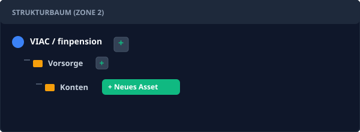
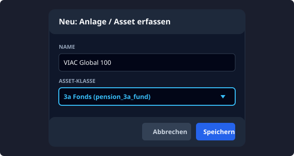
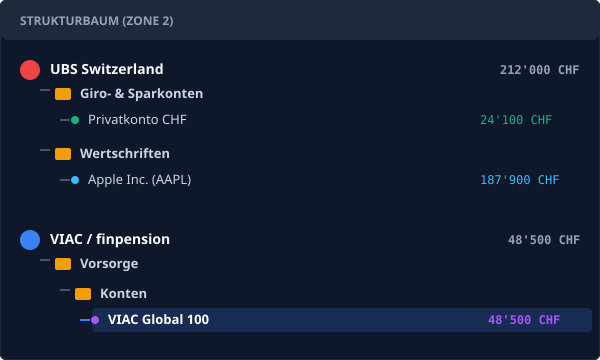

### Schritt 1: Ein Säule 3a Konto strukturieren und erfassen

Die korrekte Erfassung eines Vermögenswerts beginnt in FinBundle PRO immer mit der Anlage der entsprechenden Hierarchie im Strukturbaum (Zone 2). Dies sorgt für eine saubere, automatisierte Konsolidierung der Salden und eine korrekte Zuordnung in der Reporting-Suite.

#### 1.1 Bank und Kategorien anlegen
1. **Neue Bank anlegen:** Klicken Sie im linken Strukturbaum auf **Neu** (oder das `+` Symbol für Banken) und geben Sie den Namen des Finanzinstituts ein (z. B. *VIAC / finpension*).
2. **Kategorie "Vorsorge" erstellen:** Klicken Sie neben der neu erstellten Bank auf das **+**, wählen Sie *Neue Kategorie* und nennen Sie diese "Vorsorge".
3. **Unterkategorie "Konten" hinzufügen:** Um die Struktur weiter zu verfeinern, klicken Sie auf das **+** neben "Vorsorge" und erstellen Sie eine weitere Kategorie namens "Konten" oder "Depots".

#### 1.2 Das 3a Asset erfassen (FormModal)
Sobald die Ordnerstruktur steht, legen wir das eigentliche Finanzobjekt (Asset) an.
1. Klicken Sie neben Ihrer neuen Unterkategorie "Konten" auf das **+** und wählen Sie **Neues Asset**.
2. Im erscheinenden Dialogfenster geben Sie den Namen Ihres 3a-Kontos ein (z. B. *VIAC Global 100*).
3. Wählen Sie die exakte Anlageklasse (*Asset-Klasse*):
   * Wählen Sie **3a Cash** (`pension_3a_cash`), wenn es sich um ein reines, verzinstes Sparkonto handelt.
   * Wählen Sie **3a Fonds** (`pension_3a_fund`), wenn die Gelder in ein Wertschriften- oder ETF-Portfolio investiert sind. Diese Klassifizierung ist zwingend, damit das System später Kursgewinne korrekt berechnen kann.
4. Klicken Sie auf **Speichern**.

#### 1.3 Feinschliff im Eigenschaften-Editor (PropertyEditor)
Nach der Erstellung ist das neue Asset im Strukturbaum markiert und die rechte Seitenleiste (Zone 4) öffnet sich automatisch.
1. Kontrollieren Sie die **Währung** (für Schweizer Vorsorgekonten standardmäßig `CHF`).
2. Prüfen Sie die Checkbox **Liquides Mittel**. Bei der Zuweisung einer 3a-Klasse (`pension_3a_cash` oder `pension_3a_fund`) deaktiviert FinBundle PRO diese Box automatisch im Hintergrund, da Vorsorgegelder rechtlich gebunden sind und nicht in der Berechnung der kurzfristigen Liquiditätsreichweite (Notgroschen) auftauchen dürfen.
3. Optional: Handelt es sich um einen 3a-Fonds, der an einer Börse gehandelt wird, können Sie im Feld **Ticker (API)** das entsprechende Symbol eintragen, um die Wertanpassungen später über den LiveEditor via EODHD zu synchronisieren.
4. Alle Anpassungen im PropertyEditor werden durch die **Auto-Save** Funktion verzugsfrei in den Tresor geschrieben.

#### 1.4 Das finale Resultat
Der Strukturbaum aggregiert nun automatisch alle Ebenen. Wenn Sie weitere Banken und Assets (z.B. Ihr UBS Girokonto oder ein Aktien-Depot) hinzufügen, verdichtet FinBundle PRO die Werte in Echtzeit nach oben, während das neu erstellte 3a-Konto sauber in seiner Kategorie liegt.

### ⚠️ Troubleshooting: Die 3a Asset-Klassen im Vergleich

Häufige Zuordnungsfehler führen zu unerwartetem Verhalten bei der Performance-Berechnung oder in den Buchungsmasken. Hier sind die Unterschiede und typischen Fehlerbilder:

| Merkmal / Verhalten | 3a Sparkonto (`pension_3a_cash`) | 3a Wertschriftenfonds (`pension_3a_fund`) | 3a Verwaltetes Depot (`pension_3a_managed`) |
| :--- | :--- | :--- | :--- |
| **Typischer Anwendungsfall** | Traditionelles Bank-3a-Zinskonto (z. B. WIR, Raiffeisen) | Selbstdokumentierte ETFs/Fonds mit Stückzahl (z. B. Swisscanto) | Robo-Advisor mit täglicher Gesamtwertbewertung (z. B. VIAC, finpension, frankly) |
| **Primäre Buchungslogik** | Einzahlung / Auszahlung / Zinszahlung | Kauf / Verkauf (mit Stücken & Kursen) | Einzahlung / Auszahlung / Wertanpassung |
| **Ertragsermittlung** | Summe der Zinsbuchungen | Realisierte & unrealisierte Kursgewinne + Dividenden | Gesamtwert abzüglich investiertem Kapital (Delta) |
| **Buchungsjournal Tabs** | Ein einheitliches Transaktionsjournal | Getrennt in *Transaktionen* und *Marktdaten* | Ein einheitliches Transaktionsjournal |

#### Typische Fehlerbilder & Lösungen

1. **"Im Buchungsdialog fehlen die Felder für Stücke und Kurse!"**
   * **Ursache:** Das Asset wurde als `pension_3a_cash` oder `pension_3a_managed` deklariert.
   * **Lösung:** Stellen Sie die Anlageklasse im PropertyEditor auf `pension_3a_fund` um, falls Sie Anteile und Einzelkurse führen möchten.

2. **"Mein VIAC- oder finpension-Konto schwankt, aber ich will keine 20 Einzeltransaktionen pro Monat abtippen."**
   * **Ursache:** Fälschliche Verwendung von `pension_3a_fund` zwingt zur exakten Stückzahlführung.
   * **Lösung:** Nutzen Sie `pension_3a_managed`. Sie buchen Ihre regulären monatlichen Einzahlungen ein und erfassen zum Monatsende lediglich eine *Wertanpassung* mit dem Gesamtsaldo laut App-Auszug. Der Report weist Kursgewinne und Performance automatisch korrekt aus.

3. **"Kursgewinne tauchen fälschlicherweise als Zinsertrag auf."**
   * **Ursache:** Ein Wertschriftenkonto wurde als `pension_3a_cash` klassifiziert. Bei Cash-Konten werden positive Wertanpassungen als Zinseszins interpretiert.
   * **Lösung:** Ändern Sie die Asset-Klasse auf `pension_3a_fund` oder `pension_3a_managed`.

4. **"Neugeld wird im Vorsorge-Report nicht als YTD-Einzahlung gezählt."**
   * **Ursache:** Die Einzahlung wurde versehentlich als *Wertanpassung* verbucht oder der Buchungskommentar enthält Ausdrücke wie `#umbuchung` oder `übertrag`.
   * **Lösung:** Verwenden Sie den Buchungstyp *Einzahlung* oder kennzeichnen Sie Direktkäufe im Kommentar mit `#neugeld`.
