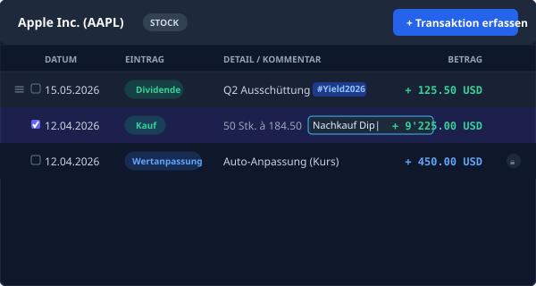
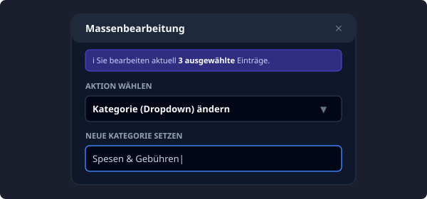
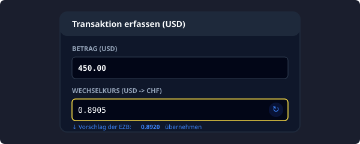
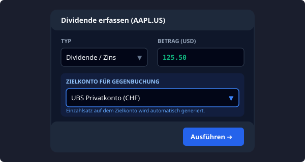

Nachdem die grundlegende Struktur (Banken und Assets) im Baum angelegt wurde, findet die operative Datenpflege in der zentralen Editor-Ansicht (Zone 3) statt. Die `EditorArea` ist das Herzstück der Datenerfassung und bietet vielfältige, auf Effizienz getrimmte Werkzeuge zur Verwaltung des Transaktionsjournals.

### 1. Einträge erfassen, verändern und löschen

Das System analysiert automatisch die im Eigenschaftseditor zugewiesene Anlageklasse und passt die verfügbaren Buchungstypen kontextsensitiv an. Einem Girokonto stehen andere Aktionen zur Verfügung als einer Aktie oder einer Hypothek.

#### Neuerfassung
- **Reguläre Buchung / Transaktion:** Ein Klick auf den blauen Button `+ Buchung erfassen` (bzw. `+ Transaktion erfassen` bei Wertschriften) öffnet das Formular (`FormModal`), um Käufe, Verkäufe, Einzahlungen oder Dividenden hinzuzufügen. Das Formular unterstützt die direkte Eingabe von Gebühren, Steuern und optionalen Notizen.
- **Stichtags-Saldo setzen:** Bei schwer nachverfolgbaren Historien (z. B. uralten Sparkonten) können Sie einen fixen Saldo an einem bestimmten Datum eintragen (`+ Stichtags-Saldo setzen`). 
  * **Wichtig:** Ein Stichtags-Saldo ist eine absolute Überschreibung. Alle regulären Ein- und Auszahlungen vor diesem Datum werden für den aktuellen Kontostand ignoriert, da der Saldo als neue, harte Baseline dient.

#### Bearbeitung & Manipulation
- **Detail-Bearbeitung:** Ein Klick auf eine bestehende Zeile im Journal öffnet den Eintrag zur rechten Seite im PropertyEditor zur tiefgreifenden Anpassung von Datum, Betrag oder Typ.
- **Inline-Bearbeitung (Kommentare & Tags):** Klicken Sie in der Listenansicht direkt auf den grauen Kommentar-Text (oder auf "Notiz hinzufügen..."), um diesen schnell anzupassen, ohne ein separates Menü öffnen zu müssen. Tags (wie `#Steuererklärung2026`) werden in der Tabelle visuell hervorgehoben und erleichtern die spätere Filterung.
- **Drag & Drop Sortierung:** Haben mehrere Buchungen exakt das gleiche Datum (z. B. ein Aktienkauf und am selben Tag eine Dividendenausschüttung), können Sie die Ausführungsreihenfolge (Custom Order) ändern. Fahren Sie mit der Maus über den linken Rand der Zeile und verschieben Sie den Eintrag per Drag & Drop.
- **Massenbearbeitung (Bulk Action):** Markieren Sie mehrere Buchungen über die Checkboxen am linken Rand. Es erscheint ein Button `Einträge bearbeiten`. Hierüber können Sie für alle markierten Einträge gleichzeitig das Datum ändern, eine neue Kategorie zuweisen, Tags überschreiben oder alle gesammelt löschen. Dies ist extrem hilfreich, wenn Sie versehentlich 20 CSV-Zeilen falsch importiert haben.

#### Löschen
- Fahren Sie mit der Maus über eine Zeile und klicken Sie ganz rechts auf das **Papierkorb-Symbol**, um den Eintrag dauerhaft zu entfernen.
- *Hinweis:* Vom System berechnete "Auto-Anpassungs"-Buchungen (Kursdifferenzen) sind mit einem Schloss-Symbol gekennzeichnet und können nicht manuell gelöscht werden. Sie passen sich automatisch an oder verschwinden, wenn Sie die echten Kauf-/Verkaufsbuchungen ändern.

---

### 2. Kontoführung in Fremdwährung & API-Abgleich

FinBundle PRO ist mandantenfähig für Multi-Währungs-Portfolios konzipiert. Jedes Asset kann in seiner eigenen Originalwährung (z. B. USD, EUR) geführt werden, während das globale Reporting sämtliche Werte live in die Basiswährung (z. B. CHF) umrechnet.

* **Zuweisung:** Die Währung eines Kontos wird im PropertyEditor (rechts) festgelegt.
* **Automatischer Kursabgleich:** Erfassen Sie eine Buchung in einer Fremdwährung, ermittelt das System bei Eingabe des Datums automatisch den passenden historischen oder tagesaktuellen Wechselkurs.
* **Frankfurter API:** Im Hintergrund greift FinBundle PRO hierfür auf die offene und datenschutzfreundliche [Frankfurter API](https://www.frankfurter.app/) (Referenzkurse der Europäischen Zentralbank) zurück.
* **Manuelle Kursüberschreibung:** Das System schlägt den API-Kurs (z. B. `1 USD = 0.89 CHF`) im Buchungsformular vor. Sie können (und sollten) diesen Wert jedoch bei jeder Buchung manuell überschreiben, falls Ihre Bank einen abweichenden Kurs inkl. Fremdwährungsspesen (Spread) abgerechnet hat, um centgenaue Abstimmungen zu gewährleisten.

---

### 3. Dividenden und das "Passive Einkommen"

Eine der häufigsten Fehlerquellen bei der Erfassung von Erträgen ist die Wahl des falschen Buchungsortes. Das System trennt streng zwischen dem reinen Geldfluss (Girokonto) und der Vermögens-Attribution (Wertpapier).

* **Der falsche Weg (Girokonto):** Buchen Sie einen Ertrag einfach als "Einzahlung" (mit Text "Dividende") auf Ihrem regulären Girokonto, erhöht dies zwar Ihren Kontostand, wird aber von der Engine **nicht** als originäres "Passives Einkommen" für die Dividenden-Reports herangezogen. Das Girokonto hat keinen logischen Bezug zur ausschüttenden Aktie.
* **Der korrekte Weg (Wertpapier):** Dividenden müssen **immer** direkt im jeweiligen Asset (z. B. der Apple-Aktie) als Typ `Dividende` gebucht werden. Nur durch diesen Schritt wird der Ertrag der Aktie zugerechnet, was die Total Return Kurve (Performance-Spikes) im Chart nach oben korrigiert und den Kursabschlag kompensiert.
* **Die Automatik-Gegenbuchung:** Um den Geldfluss von der Aktie auf Ihr Bankkonto logisch abzubilden, bietet FinBundle PRO beim Erfassen der Dividende das Feld `Zielkonto für Gegenbuchung` an. Wählen Sie hier Ihr Giro- oder Verrechnungskonto aus. Das System verbucht die Dividenden-Performance auf der Aktie und transferiert den Geldbetrag im gleichen Arbeitsschritt unsichtbar und automatisiert als "Dividenden Eingang" auf Ihr Bankkonto.

---

### ⚠️ Troubleshooting: Editor & Kontoführung

Wenn Transaktionen nicht wie gewünscht verarbeitet werden, prüfen Sie folgende typische Fehlerbilder:

| Symptom | Ursache & Lösung |
| :--- | :--- |
| **"Der Wechselkurs wird beim Eintragen nicht automatisch geladen."** | **Ursache:** Sie sind offline, die Frankfurter API hat ein Rate-Limit erreicht, oder das System blockiert die Anfrage. **Lösung:** Das System fällt auf einen Offline-Richtwert (Mock-Map) zurück (z. B. USD zu CHF: 0.89). Sie können diesen Wert manuell überschreiben. Prüfen Sie Ihre Internetverbindung und klicken Sie auf das kleine *Refresh-Icon* neben dem Kursfeld. |
| **"Meine Dividenden tauchen nicht im 'Passives Einkommen' Report auf."** | **Ursache:** Die Dividende wurde als normale Einzahlung auf dem Girokonto verbucht statt auf dem Wertpapier. **Lösung:** Löschen Sie die Einzahlung auf dem Girokonto. Erfassen Sie stattdessen eine `Dividende` direkt auf dem Aktien-Asset und wählen Sie im Feld `Zielkonto für Gegenbuchung` Ihr Girokonto aus. |
| **"Ich kann eine Buchung mit dem Titel 'Auto-Anpassung' nicht löschen."** | **Ursache:** Dies ist ein berechneter System-Eintrag (gekennzeichnet mit einem Schloss-Symbol). Das System nutzt diesen, um Differenzen zwischen Ihrem investierten Kapital und dem realen Börsenkurs auszugleichen. **Lösung:** Sie müssen diese nicht löschen. Wenn Sie die echten Stücke (Kauf/Verkauf) oder den Börsenkurs korrigieren, bereinigt das System diese Auto-Anpassung vollautomatisch. |
| **"Drag & Drop funktioniert nicht, die Zeile lässt sich nicht verschieben."** | **Ursache:** Sie versuchen, Buchungen über verschiedene Tage hinweg zu verschieben. **Lösung:** Drag & Drop (Custom Ordering) funktioniert ausschließlich für Buchungen, die **am exakt gleichen Datum** stattgefunden haben. Um eine Buchung auf einen anderen Tag zu verschieben, müssen Sie diese anklicken und das Datum in den Eigenschaften ändern. |
| **"Mein Kontostand stimmt nicht mit den Buchungen überein."** | **Ursache:** Möglicherweise ist weiter oben in der Historie ein *Stichtags-Saldo* definiert. **Lösung:** Prüfen Sie das Journal auf blau markierte "SALDO"-Einträge. Diese ignorieren alle Buchungen, die chronologisch *vor* diesem Saldo stattfanden, und setzen den Wert hart auf die eingetragene Summe zurück. |
